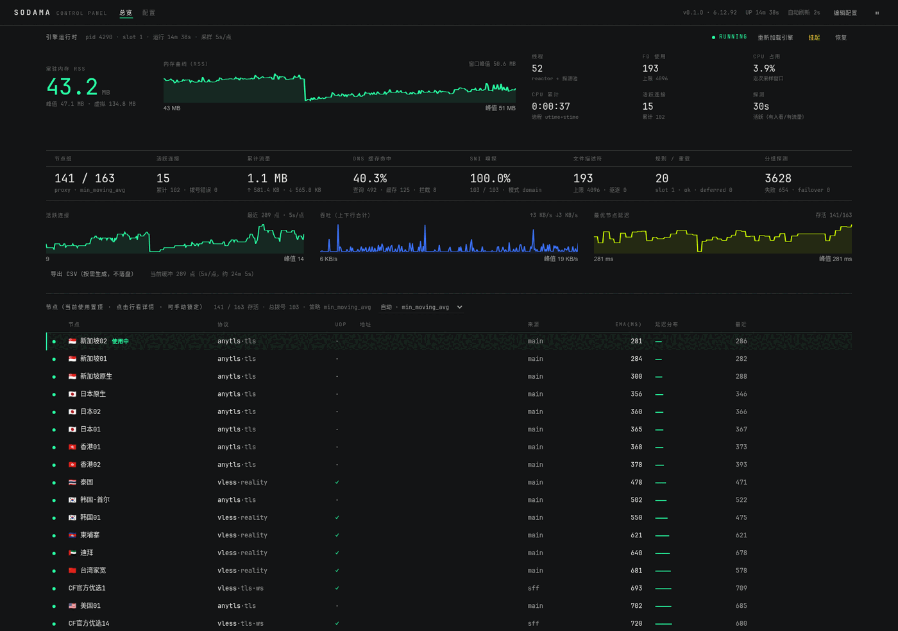
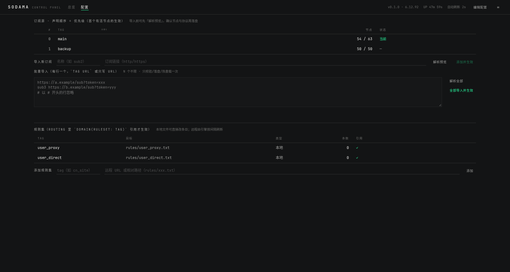
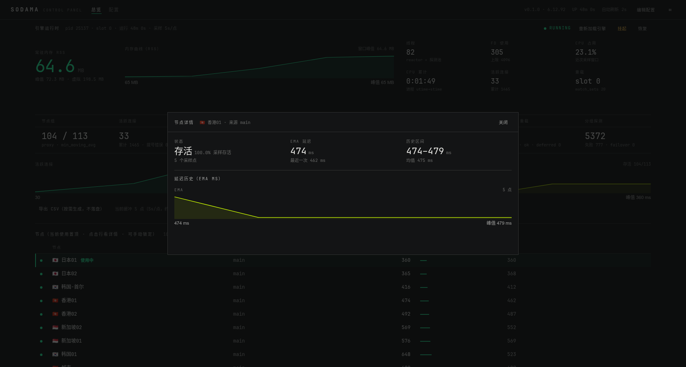

# sodama · dae 核心数据面的 Rust 重写研究

[`dae`](https://github.com/daeuniverse/dae)（Go + eBPF 的透明代理网关）核心数据面的
**Rust 重写实验工程**：可运行、可对拍、可复现，附带从源码研究到架构决策的完整文档。
*An experimental, ground-up Rust (aya-ebpf/aya) rewrite of dae's core datapath, with
byte-exact parity tests against dae's Go rule compiler and a netns test lab.*

> **公开版说明**：本仓库由私有研究工程整理而来；订阅端点、节点域名、公网 IP、生产环境凭据均已脱敏，测试数据为脱敏记录。许可证 **AGPL-3.0-only**，与上游 dae 一致。研究方法与证据分级见 [`docs/methodology.md`](docs/methodology.md)。

- **数据面（eBPF）**：14 个 TC 程序（7 个角色 × 2 种链路头）+ 1 个 `sk_skb` offload verdict
  + 14 张 BTF map，全部为 Rust/aya-ebpf，**无 C 数据面**（P9+，ADR-0025）。
- **控制面（用户态）**：Rust + aya 加载器——`.dae` 全量配置解析与规则编译、
  透明 DNS 接管（缓存/TCP/regex/EDNS）、TCP relay / UDP NAT / TCP offload、
  协议栈 shadowsocks / trojan / vless（tcp/ws）/ vmess / tuic / hysteria2 / **anytls**（含 UDP 与会话）、
  状态面 / 热重载 / 指标导出；vless 的 **WebSocket 传输**与 **AnyTLS** 已接入真实订阅节点
  （ADR-0026 / ADR-0027），支持 **真网关模式**（宿主流量透明接管，浏览器零配置，ADR-0029）
  与 **用户态嗅探 + dial_mode**（TLS SNI/HTTP Host → 域名交节点远端解析，绕 DNS 污染，ADR-0030）、
  **订阅/节点组**（`--subscribe` + group filter/policy + 经节点健康探测与失败切换，ADR-0031）。
- **lab**：netns 拓扑（标准 + 单臂）、`verify` 9 用例、DNS / 转发面 / 协议梯 / 运维专项、
  soak、与 dae 原版 Go 规则编译器的**逐字节对拍**、真实 Go 客户端跨实现联调、
  双内核矩阵（宿主 + QEMU 第二内核）；**本地 SOCKS5 入口**（`--listen-socks`，零 root/零 eBPF，
  浏览器可直接指向验证真实节点，ADR-0028）；**真网关模式**（`lab/gateway.sh`，物理网卡不移动、
  eBPF 透明接管宿主流量，ADR-0029）。
- **控制台（Web）**：Rust 后端（axum）+ Rust→WASM 前端（Leptos）的**单文件 musl 二进制**，
  跑在软路由上（~3 MB RSS）：总览（运行时/曲线/节点表）+ 配置页（订阅/规则集/分流条目在线改，
  validate 护栏 + 热重载回执），**引擎零改动**（见 [`panel/`](./panel/README.md)）。
- **生产实战（第二阶段，2026-10-08 起）**：真网关模式在 OpenWrt 软路由（x86_64 / 2 核 / 4 GB）上线，
  接管全屋流量、接入真实订阅（REALITY / anytls / vless 混合）；四轮侦查/修复全部落地——健康探测线程
  卡死与泄漏、粘滞 IP「永不重解析」、热重载超时误报、订阅截断静默通过（见
  [`docs/phase2-devlog.md`](./docs/phase2-devlog.md)）；长期运行记录见 devlog。

实验室全量回归（唯一 Rust 数据面；2026-10-06 基线，后续 CI 持续更新）：

| 项 | 结果 |
|---|---|
| 单元测试 `cargo test --release --workspace` | **352 + 3 passed**（2026-11-10 公开版复跑；7 ignored） |
| 转发面核心回归（真实转发 / janitor 回收 / **泵线程泄漏回归**） | 3/3（新用例双向验证：修复版 PASS、回退旧语义 FAIL） |
| `verify`（标准 / 单臂拓扑） | 9/9 · 9/9 |
| DNS 专项（domain/cache/tcp/reload/edns/regex） | 6/6 |
| 转发面专项（relay/idle/offload/lifecycle/udp） | 6/6 |
| K3 + 运维（config/status/forward/整配置热重载/ops） | 5/5 |
| 协议梯（ss/trojan/vless/vmess/tuic/hysteria2 全变体） | 15 会话、17/17 |
| 规则对拍 vs dae Go 编译器 | 5/5 逐字节一致 |
| soak（tcp 60s / ss 30s / udp 30s） | 无失败轮、无泄漏 |
| 内核矩阵（6.18.54-lts 宿主 + 7.2.8 QEMU） | 9/9 · 9/9 |

> **后续版本（Backlog，本版不做）**：工程化打包（Docker 镜像、发行包、发行 CI、
> shell 补全、Makefile、PKGBUILD、许可证一致性审计、install.sh 升级回滚…）与
> 协议/数据面余项（其余 SIP003 插件、SSR auth_*/obfs_*、ECH 前置条件、eBPF L2/cgroup/ringbuf、
> include 展开、UDP endpoint pool、fuzz、同机对拍、README 状态区重写等）已固化为全量清单
> （含验收标准）：[`docs/backlog.md`](docs/backlog.md)。
>
> **性能与资源边界（现行报告）**：吞吐四方对拍（direct/ss/vless/vless-tls，含 M1 splice 与 M2 kTLS 前后）、
> 四层内存模型（Process → Kernel → Total → per-connection）、FD 治理、转发原语对照、长稳与
> **五万并发压测**见 [`docs/benchmark-report.html`](docs/benchmark-report.html)（自包含可离线打开；
> perf-report / memory-report v1·v2 已并入，保留为存档）。复现：`sudo lab/perf/run.sh all` · `lab/perf/mem-system.sh`。

## 第二阶段 · 生产实战（2026-10-08 起）

真网关模式部署在 OpenWrt 软路由上接管全屋流量，转入「问题 → 侦查 → 结论 → 动作 → 验收」的
生产实战轮（逐条证据见 [`docs/phase2-devlog.md`](./docs/phase2-devlog.md)）：

| 轮次 | 根因（暴露面） | 修复 | 生产验收 |
|---|---|---|---|
| §7–§8 探测卡死 | `thread::scope` 等齐探测批 + 无超时读 → 探测冻结，拨号失败率 40%；组拨号绕过 Reactor；远程规则集自锁；日志无时间戳 | 探测硬超时 + 带超时收集；组拨号回归 Reactor；规则集软失败 + 面板回滚；日志时间戳 | Reactor 接管 12/12（100%）；`relay` 线程 36→0；线程斜率 +2.39→−0.11 |
| §9 线程泄漏（§8 回归） | 握手读无超时 + 探测线程无上限 → 553 个 `recvfrom` 阻塞线程 | `SO_RCVTIMEO` 设/清 + 探测上限 96 + **拨号墙钟看门狗**（到点 `shutdown`） | `stragglers` 归零（25 h 0/1486）；`dial_errors` 0；探测看门狗从未触发 |
| §10–§11 看护/热重载 | 粘滞 IP「只作废不重解析」（subA 63→6 存活）；reload 同步拉订阅（19–34 s 超时误报）；失败源被全量替换清空；截断正文静默通过 | `sticky::resolve_for_dial`；reload 与拉取解耦；按源保留成员；Content-Length 精确校验；磁盘缓存 + 周期刷新 + 自愈重试 | 面板回执 19–34 s → 0.74 s；组 100 成员（继承健康）；截断实战捕获 ×2 并自愈；重启不丢源 |

**修复后稳态**（25 h 曲线，1486 采样）：RSS 平台 **50–53 MB**（重启瞬时 39.4 MB）；线程 16–66；
`stragglers` **0/1486**；探测看门狗从未触发；三次热重载前后内存无跳变。

**长期运行验证**（2026-10-08 起）：真网关在 OpenWrt 软路由上连续运行，判据为相对 1 h 基线漂移 ≤5% 且失败零增长；完整运行协议、记分板与遗留监控台账见 devlog §12。

## 仓库结构

```
docs/                        决策、架构与报告
├── architecture-decision.html   主决策档案（自包含 HTML，可离线打开）
├── README.md                    文档索引与证据分级约定
├── adr/                         ADR-0001..0063（背景/决策/后果/验证方式）
├── modules/                     协议字节级规格（tuic-v5 / hysteria2）
├── reviews/                     第三方评审原文存档 + 工程方采纳提案（I1–I5）
├── benchmark-report.html        ★ 性能与资源边界报告 v3.0（合并版：吞吐对拍 + 四层内存 + 五万并发压测）
├── memory-report-v2.html        内存终测 v2.1（已并入 benchmark-report；存档）
├── project-summary.html         工程总结报告
├── perf-report.md               四方性能对拍（已并入 benchmark-report；存档）
├── parity-status.md             对标进度：dae（Go）↔ sodama（全 Rust）分域覆盖度
├── phase2-devlog.md             第二阶段（生产实战轮）开发记录（侦查/修复/验收 + 长期运行记分板）
└── notes/                       本地工程笔记（**不入库**：含真实订阅/节点信息，见 .git/info/exclude）

sodama/                    引擎（构建、实验、测试都在这里）
├── loader/                    Rust 用户态：加载器 / 规则编译 / DNS / relay / 协议栈 / 状态面
├── ebpf-rs/                   Rust eBPF 数据面（aya-ebpf，bpfel-unknown-none + BTF maps）
├── lab/                       netns 实验环境与全部测试脚本
│   ├── lab.sh                 拓扑 / 会话 / 9 用例 verify / 各专项
│   ├── gateway.sh             真网关模式一键脚本（up/down/status/test；宿主流量透明接管）
│   ├── bench.sh bench_io.c    性能剖面（六路径）
│   ├── soak.sh                长时打流 + reload/suspend 泄漏检查
│   ├── parity.sh + parity/   与 dae Go 编译器的规则编译对拍（逐字节）
│   ├── proto-check/           真实 Go 客户端 / Go 参考服务端跨实现联调
│   ├── real-node-e2e.sh       真实 vless-ws 订阅节点端到端验收（env 注入节点）
│   ├── matrix.sh              内核矩阵（宿主 / QEMU 第二内核）
│   └── prod/                  生产健康曲线：health-track.sh + health-plot.py（判据线内建）
├── README.md                  实验手册：构建、拓扑、会话、实测输出
└── NOTES.md                   数据面/协议栈的源码级笔记（带行号与坑清单）

panel/                     控制台（Web）：控制平面，只读引擎契约（见下节）
├── backend/                   axum：REST / CSV / 状态采样（直连 unix socket，不 fork）
├── frontend/                  Leptos CSR → WASM（Tufte 式极简暗色）
├── shared/                    前后端共享 DTO（serde）
├── deploy/                    panel.conf 模板 + procd init
└── scripts/                   build-router / deploy / dev-local（密码经 PASS 环境变量传入）

install/                    OpenWrt 打包（Makefile / kernel fragment / procd 服务）
dae/                         上游 dae clone（不入库；对拍工具按需在仓库同级 clone，见下）
```

## 控制台（`panel/`）

**后端 axum + 前端 Leptos→WASM**，编译为单文件 musl 静态二进制，跑在 OpenWrt 软路由上：
二进制 ~2.6 MB + 静态资源 ~940 KB，常驻 **~3 MB RSS / 3 线程**（无浏览器访问时不采样）。



| | |
|---|---|
|  |  |

- **总览**：引擎运行时卡片（RSS / 峰值 / 虚拟内存 / 线程 / FD / CPU / 连接 / 重载槽位 + 内存曲线）、
  运行指标三线表、曲线（连接/吞吐/最优节点延迟）、CSV 按需导出、节点表
  （协议·传输·安全 / UDP / 地址 / 来源 / EMA / 延迟分布；当前节点高亮、**手动锁定节点**）。
- **配置页**：订阅增删排序与**批量导入**（导入前调引擎 `sub-parse` 解析预览）、规则集、
  本地规则文件条目编辑、**内核参数可视化**（`global`/`dns`/`group` 白名单 36 项：分组 + 默认值 + 一行说明 + 类型化控件）；
  写入一律「validate 护栏 → 落盘 → 等热重载回执」，不存在“要重启才生效”的旋钮。
- 与引擎的交互全走既有契约（unix socket 状态面 / metrics / inotify 热重载）——**引擎零改动**，
  配置即唯一事实来源；详见 [`panel/README.md`](./panel/README.md)。
- **数据新鲜度**：运行时卡片带 `数据 Ns 前` 指示（>12s 转黄告警）——一眼分辨“面板/引擎卡住”
  与“RSS 本来就稳”；内存曲线同时标出 **Δ 与窗口区间**，并叠一条同窗口活跃连接曲线。
- **手机适配**：窄屏单列、节点表收起次要列（点行看详情）、宽表横向滑动、弹窗全屏。

## 快速开始

依赖：Linux（建议内核 ≥ 5.17；≥ 6.6 走 TCX）、Rust（stable + nightly + `rust-src`）、
`bpf-linker`、`libbpf` 头文件、`ip`/`tc`/`bpftool`、python3（`cryptography`）、
gcc（仅压测夹具 `lab/bench_io.c`）。

> **安全提示**：sodama 以 root/特权运行 eBPF；Web 面板默认只监听 `127.0.0.1:8080`，**非回环绑定且未设置 token 时会拒绝启动**。不要在公网暴露未鉴权的控制面板。

```bash
cd sodama
lab/lab.sh build           # 构建 Rust 加载器 + Rust eBPF 对象（不需要 root）
sudo lab/lab.sh up         # 建 netns 拓扑并启动
sudo lab/lab.sh verify     # 9 个用例（含单写者、状态面与故障注入）
sudo lab/lab.sh down

# 真网关模式（真实节点，浏览器零配置；节点 URL 放 /tmp，详见 sodama/README.md）
#   sudo lab/gateway.sh up --node /tmp/sodama-node.url
#   lab/gateway.sh test && sudo lab/gateway.sh down    # 快检后回滚
```

详细的拓扑说明、全部会话/测试清单与实测输出见 [`sodama/README.md`](./sodama/README.md)；
数据面机制与坑清单见 [`sodama/NOTES.md`](./sodama/NOTES.md)。

## 文档

- [`docs/architecture-decision.html`](./docs/architecture-decision.html) — 主决策档案：
  上游 dae 的模块/规模分析、Rust 重写的收益与风险、部署形态（Rust worker + eBPF 分流）、
  决策点 D1–D8 与迁移路线（K0–K3、P3–P18）。
- [`docs/phase2-devlog.md`](./docs/phase2-devlog.md) — **第二阶段 · 生产实战轮**开发记录：
  软路由生产环境自 2026-10-08 起的四轮侦查/修复（探测卡死与线程泄漏、粘滞 IP 重解析、热重载解耦、
  按源保留、订阅正文完整性）+ 长期运行记分板与遗留监控台账。
- [`docs/security-proposal.md`](./docs/security-proposal.md) — **安全工程提案（待采纳）**：
  攻击面取证（9 类输入 × 解析器 × 现有防线）、nightly + bpf-linker 供应链缺口，
  S0–S5 排期（fuzz ≥8 目标、QEMU 特权加载 CI、工具链钉死与 cargo-deny、panic 面与默认暴露面收紧）。
- [`docs/adr/`](./docs/adr/) — 63 条已采纳 ADR（ADR-0001..0063）：每个决策的背景、选项、理由、后果、
  **实测验证方式**与修订条件。重要节点：0002（eBPF 程序语言：先 C 后迁）、
  0023/0024/0025（数据面 Rust 全量迁移 → C 对象退场）、0029（真网关模式）、
  0030（嗅探 + dial_mode）、0031（订阅/节点组/健康检查）、0032（IPv6 数据面 TCP 全链）、
  0033（geoip/geosite 展开 + pname）、0034/0035/0036（DoT/DoH/DoQ 上游 + dns.routing 分流）、
  0037–0057（DNS 黑名单/ECS/sip/REALITY-Vision、多组调度、QUIC SNI 嗅探、naive、h3、juicity、
  SSR、shadow-tls、ECH 边界等协议细节）、0058（M4 reactor：每连接 0 线程）、0059（I6 零线程握手）、
  0060–0062（运行时参数热更新 / 订阅顺序与默认配置 / inotify 配置即事实来源）、0063（规则集与用户分流名单）。
- [`docs/reviews/`](./docs/reviews/) — 第三方评审原文存档（内存终测 A/B）+ 工程方采纳提案（I1–I5）。
- [`docs/parity-status.md`](./docs/parity-status.md) — 对标进度：dae（Go）↔ sodama（全 Rust）
  分域覆盖度对照（15 域 + 汇总 + Top 缺口 + 优势项，逐行附证据锚点）。
- [`docs/modules/`](./docs/modules/) — tuic v5 / hysteria2 的字节级客户端规格。
- [`docs/methodology.md`](./docs/methodology.md) — 研究方法与可复现性：证据分级、与 dae 的逐字节对拍、性能口径、脱敏规则。

## 研究方法与可复现性

本仓库按「可运行、可对拍、可复现」组织：

- **证据分级**：结论标注「已实测 / 源码实测 / 推断」，引用代码时使用 `文件:行号`。
- **三级验收**：单元测试 → netns lab 专项 → 真实节点/真网关验收；边界项明确登记，不把未做写成已做。
- **对拍**：规则编译与 dae 原版 Go 编译器逐字节对比；协议实现与 Go/参照客户端跨实现联调。
- **性能口径**：进程 CPU、内核侧 CPU、四层内存分开记账；固定节点/固定后端/固定目标，短传输判定与重试规则写入脚本。
- **脱敏**：公开仓库不保存真实订阅 URL、token、节点域名或生产环境凭据；公网 IP 使用 RFC 5737/3849 文档保留地址。测试数据保留相对结论与复现方法。

## 贡献与安全

- 贡献指南：[`CONTRIBUTING.md`](./CONTRIBUTING.md)
- 安全策略与漏洞报告：[`SECURITY.md`](./SECURITY.md)
- 第三方声明：[`NOTICE`](./NOTICE) / [`THIRD_PARTY_LICENSES.md`](./THIRD_PARTY_LICENSES.md)

## 上游与许可

- 本仓库是对 dae（Go + eBPF）的**学习/研究性 Rust 重写**，不是 dae 官方项目；
  许多语义、map 布局与协议实现以 dae 源码为参照（逐项记录在文档与注释中）。
- 许可证：**AGPL-3.0-only**（见 [`LICENSE`](./LICENSE)）。上游 dae 与 daeuniverse/outbound 均为 AGPL-3.0；本仓库保持同一许可证，不提供 GPL-3.0 重新许可。
- 上游代码不随本仓库分发：`dae/` 与 `sodama/lab/parity/dae-work/` 均在
  `.gitignore` 中。需要运行规则对拍/跨实现联调时，把 dae clone 到本仓库同级目录：

  ```bash
  git clone https://github.com/daeuniverse/dae dae
  cd sodama && lab/parity.sh          # 逐字节对拍 dae 的 Go 规则编译器
  ```

- 唯一保留的 C 源文件是压测服务端夹具 `sodama/lab/bench_io.c`（不属于数据面）。
- 第三方代码/数据声明见 [`NOTICE`](./NOTICE) 与 [`THIRD_PARTY_LICENSES.md`](./THIRD_PARTY_LICENSES.md)。
- 第三方商标与项目名称归其各自所有者；本仓库与 daeuniverse 无隶属关系。
