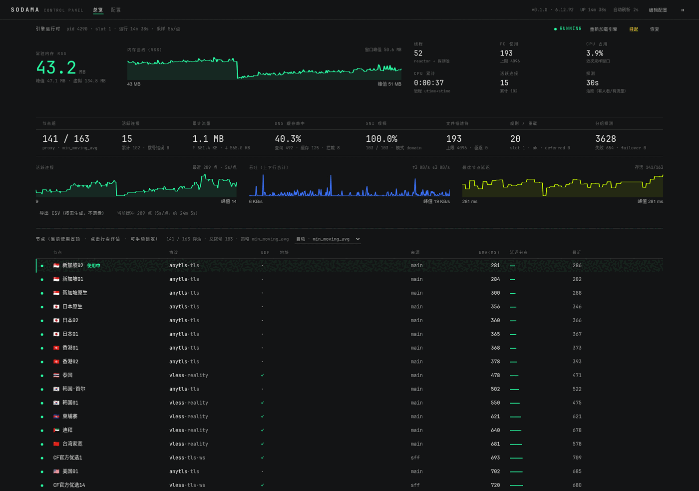
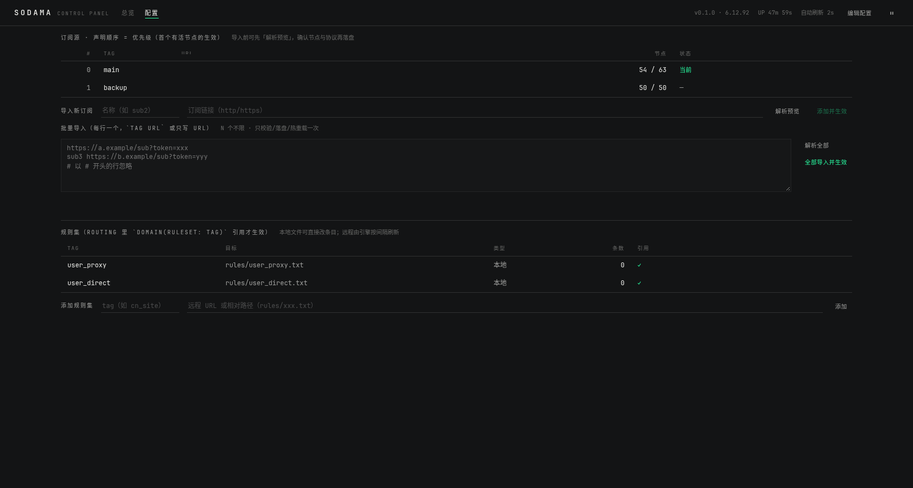
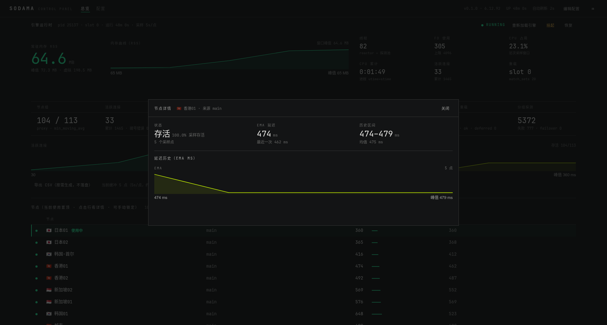

# sodama 控制面板（sodama-panel）

给 [sodama](../) 引擎做的 Web 控制面板：**后端 Rust（axum）+ 前端 Rust→WASM（Leptos CSR）**，
单文件 musl 静态二进制，适合跑在 OpenWrt 软路由上。

> 本仓库（sodama monorepo）的控制台部分：与引擎 `sodama/` 同库演进，共享同一套只读契约；
> 接口稳定后可整体拆为独立仓库（见根 README「仓库结构」）。
>
> 截图见 `docs/`（节点地址/订阅地址已脱敏）；含真实节点与订阅信息的原因存在
> `docs/private/`，**不入库**（`.gitignore`）。



| | |
|---|---|
|  |  |

## 功能

顶部两个页面：**总览**（只读仪表盘）/ **配置**（结构化改配置）。

| 模块 | 内容 |
|---|---|
| **引擎运行时**（总览首屏重点） | 大号 RSS + 内存曲线 + **活跃连接同窗曲线**；**数据新鲜度**（`数据 Ns 前`，>12s 转黄告警“已停更”——一眼分清“面板/引擎卡住”与“内存本来就稳”）；内存曲线标 **Δ 与窗口区间**（`Δ +0.3 MB / 10min · 窗口 50.8–51.1 MB`）；专业参数：峰值/虚拟内存、线程、FD 使用（含上限）、CPU 占用/累计、活跃连接、重载槽位、**引擎构建**（`sodama --version` 的 git sha / dirty / 版本）；右侧控制动作（重新加载引擎 / 挂起 / 恢复） |
| 运行指标·**三线表** | 表头线 + 数值行 + 注释行（无竖线）：节点组 / 活跃连接 / 累计流量 / DNS 缓存命中 / SNI 嗅探 / 文件描述符 / 规则重载 / 分组探测 |
| **数据面卡片**（v2.0） | 与三线表同构，三组读数：**UDP NAT**（流量/会话/代理比/full-cone/负缓存+GSO 聚合：`gso_sends`/`gso_datagrams`/`gso_unsupported`）/ **卸载与零拷贝**（offloaded 累计/splice/reactor codec/pipe 池泄漏 = 创建−归还）/ **错误面**（溢出・丢弃・域发布失败・卸载记账失败合计，**正常应恒为 0，非零整格转警告色**）+ **观测**（sysctl watched/rewrites、域名确认集、trace 会话状态） |
| 曲线 | 活跃连接 / 吞吐（↑↓） / 最优节点延迟；**内存环形缓冲**（默认 5s×1440 点 ≈ 2h）+ 卡片内 RSS 曲线 |
| **CSV 导出** | `GET /api/v1/series.csv`——**按需生成、不落盘**；列含 `rss_kb/rss_mb/threads/cpu_pct`（内存与 CPU 可导出做趋势分析） |
| 节点 | 列表：节点 · **协议（含传输/安全）** · **UDP 能力** · **服务器地址** · 来源 · EMA · 延迟分布 · 最近；**点击看详情**（延迟历史 + 协议/传输/安全/地址/UDP 事实）；深链 `#node=<tag>\|<name>` |
| **当前节点高亮** | 引擎上报 `group.current`（select_order 首位 = 新连接优先走的节点）→ 置顶 + 亮绿竖条 + 「使用中」标 |
| **手动切节点** | 行内「锁定」→ 写 `policy: fixed('节点名')`（**按名字点名**，订阅重排不指错）；「恢复自动 / 解锁」→ `min_moving_avg`；顶部可选 min / min_avg10 / random；**reload 即时生效，不需重启** |
| 订阅源 | 顺序/tag/URL（脱敏）/节点数/存活；**一键「设为主源」**（改配置 + 热重载 + 回执）→ 列表与控制已迁至**配置页**（总览不再重复展示） |
| 规则集 | 本地/远程/缓存标记、更新于、**下次自动刷新倒计时**、**立即刷新**（reload） |
| 控制 | 热重载 / 挂起 / 恢复（危险操作二次确认；reload 以 `reload.at_sec` 推进为真实判据）——位于运行时卡片内 |
| **运维工具行**（v2.0） | 与引擎 A1/A2 取证面对齐：**drain**（`--drain=N` 旧代在飞会话排空预算）与 **abort**（`--abort` 中断在飞会话）直接作用于 reload/suspend；**抓取事件**（`sodama trace` 短时会话：秒数 1–30 / 全部·TCP·UDP / 只看丢弃，结果就地展开、服务端截断 1000 行）；**下载诊断包**（`sodama sysdump` 的 tar.gz：status/rules/config/maps + system + 现场 ip/nft/iptables/sysctl，用完即删） |
| 配置编辑 | `config.dae` / `rules/*.txt` / `blocklist*` 在线编辑；**先 validate 再落盘**（退出码≠0 或 deferred>0 拒结）；深链 `#editor` |
| 日志 | 日志尾（新→旧，自动刷新，可暂停） |
| **配置页·订阅** | 列表（顺序/tag/URL 脱敏/节点数/存活/当前源）+ 上移/下移/删除 + **导入新订阅**：先「解析预览」（调引擎 `sub-parse` 真实拉取解析：节点数、协议分布、头信息条目、逐条节点名）确认无误再「添加并生效」 |
| **批量导入** | 一个文本框每行一个（`tag url` 或只写 url，自动起名 sub2/sub3…），**N 个不限**；「解析全部」逐个预览，「全部导入并生效」只校验/落盘/热重载一次 |
| **配置页·规则集** | 本地/远程规则集列表（条数、是否被 `routing` 引用）；添加远程 URL 或本地路径；删除 |
| **配置页·分流条目** | 本地规则文件直接增删条目（去重、URL 自动归一化为域名、支持 `full:`/`suffix:`/`keyword:`/`regex:` 前缀）、过滤查看、单条删除 |
| **配置页·内核参数** | 把引擎可设置的能力（`global`/`dns`/`group` 白名单，v2.0：**55 项**）做成表单：分组（转发/探测/订阅/DNS/性能/TLS 与抗封锁/日志）+ 每项默认值与一行说明；开关/枚举用下拉、时长/int/文本用输入框；**改了写回 config.dae → validate 护栏 → 热重载回执**，空值 = 恢复引擎默认；已改项用强调色标出 |
| **HTTPS** | 可选（`tls = 1`）：首次启动自动生成自签证书（key 0600），HTTP/HTTPS 并存 |
| 鉴权 | token 会话（HttpOnly Cookie）；默认仅监听回环，**非回环绑定且 token 为空时拒绝启动** |
| **手机适配** | 窄屏单列：节点表收起次要列（UDP/地址/来源/延迟分布/最近，点行看详情），配置页宽表横向滑动，弹窗全屏；触摸设备行内动作常显（无 hover）、点击目标加大 |

## 结构

```
panel/
├── shared/      # 前后端共享 DTO（serde）
├── backend/     # axum：REST + CSV + SSE 预留；数据来自执行 sodama 子命令
├── frontend/    # Leptos CSR → WASM（Tufte 式极简暗色）
├── scripts/     # build-router.sh / deploy.sh / dev-local.sh
└── deploy/      # panel.conf 模板 + procd init
```

## 开发 / 构建 / 部署

```bash
HOST=root@192.0.2.10 PASS=xxx scripts/dev-local.sh   # 本机开发（数据经 SSH 取路由器）→ http://127.0.0.1:8099
scripts/build-router.sh                      # wasm + musl 构建 → dist/{sodama-panel,www}
HOST=root@192.0.2.10 PASS=xxx scripts/deploy.sh   # 停服务→推送→procd 重启（HOST/PASS 必填）
```

`HOST` 与 `PASS` 都必须通过环境变量传入（脚本不内置默认目标/密码）。

产物（v2.0 实测）：二进制 **2.8 MB**（含 TLS）、静态资源 **~1.2 MB**（wasm 1.17 MB + JS/CSS，未压缩传输——同机/局域网口径）、常驻 **~3 MB RSS / 3 线程**（OpenWrt 软路由）；无浏览器访问时不采样、不 fork。

## API

| 方法 | 路径 | 说明 |
|---|---|---|
| GET | `/api/v1/health` | `{ok, auth_required}` |
| POST | `/api/v1/login` \| `/logout` | 会话登录（`token` 为空时 login 直接返回 ok） |
| GET | `/api/v1/status` \| `/status/raw` | 状态（裁剪 DTO / 引擎原始 JSON） |
| GET | `/api/v1/logs?tail=300` | 日志尾 |
| GET | `/api/v1/metrics` | Prometheus 文本（原样） |
| GET | `/api/v1/series?points=360` | 采样曲线 |
| GET | `/api/v1/series.csv?points=1440` | **CSV 导出（按需、不落盘）** |
| GET | `/api/v1/node?tag=&name=` | 单节点详情 + 历史 |
| GET | `/api/v1/sources` | 订阅源（脱敏 URL、节点统计、活动标记） |
| POST | `/api/v1/sources/promote` | 把某源调为第一顺位（no-op 立即返回） |
| GET | `/api/v1/config?raw=1` | 引擎配置（默认脱敏） |
| GET | `/api/v1/files` · `/files/content` | 可编辑文件白名单 / 读 |
| POST | `/api/v1/files/content` | 保存（validate → 落盘 → 等热重载回执） |
| POST | `/api/v1/actions/{reload,suspend,resume}` | 控制（需 `enable_actions = 1`）；载荷可选 `{drain_secs, abort}`（v2.0：对应引擎 `--drain=N`/`--abort`） |
| GET | `/api/v1/engine/version` | **引擎构建信息**（v2.0：`sodama --version` 解析为 version/git_sha/dirty/toolchain；缓存 10 分钟） |
| POST | `/api/v1/engine/trace` | **短时内核 trace**（v2.0：`{seconds 1..30, ipv4/ipv6, l4, port, drop_only}` → `{ok, lines, total_lines, truncated, file, message}`；阻塞 seconds 秒，服务端截断 1000 行） |
| GET | `/api/v1/engine/sysdump` | **诊断包下载**（v2.0：生成 tar.gz 后作为附件返回，临时文件用完即删，体积上限 32 MiB） |
| POST | `/api/v1/config/inspect` | **订阅解析预览**（只读，调引擎 `sub-parse`） |
| GET \| POST | `/api/v1/config/params` | **内核参数**：GET 回显配置文件里显式写了的键；POST `{section,key,value}` 写回（空值 = 删键回默认），类型化校验 + 热重载回执 |
| POST | `/api/v1/config/subs` \| `/subs/remove` \| `/subs/move` \| `/subs/bulk` | 订阅增/改/删/上移下移/**批量导入**（改 `config.dae` + validate 护栏 + 等热重载） |
| POST | `/api/v1/config/group/policy` | **手动切节点**：`{policy:"fixed", node:"节点名"}` 锁定 / `{policy:"auto"}` 恢复自动（写 `group.<name>.policy`，reload 即时生效） |
| POST | `/api/v1/config/rulesets` \| `/rulesets/remove` | 规则集增/改/删 |
| GET | `/api/v1/config/rule-files` | 规则集列表 + 本地文件条目（尾部最多 500） |
| POST | `/api/v1/config/rule-files/{add,remove}` | 本地规则文件条目增/删（自动 reload） |

单内核设计：面板只对接一个本地引擎（平铺键配置），多引擎与 `?engine=<id>` 已移除。

**配置页为什么不需要改内核**：`config.dae` 是唯一事实来源，引擎用 inotify 目录级监听
（含 `rule_set` 指向的文件）毫秒级热驱动。面板只做「改文本 → `validate` 护栏 → 落盘 →
等 `reload.at_sec` 推进作为回执」；唯一的引擎侧新增是**只读**子命令 `sodama sub-parse`（解析预览）。

## 与引擎的交互方式（都为了「不打扰」）

| 通道 | 说明 |
|---|---|
| 状态面（默认） | **直连 unix socket**（写一行 `status`/`metrics`，读到 EOF）——不再每次 fork 一个 7.4MB 的 CLI 子进程 |
| CLI 子进程 | 仅在 `status_cmd`/`metrics_cmd` 被显式覆盖（如 SSH 远端引擎）时使用 |
| 日志 | 默认 `tail` 形式时面板**直接读日志文件尾**（回看 512KB），不 fork `tail` |
| 采样 | 默认**只在有人看面板时采样**（`sample_when_idle = 1` 可恢复常驻采样） |
| 构建信息 | `sodama --version`（不需 root/socket），面板缓存 10 分钟 |
| 取证（trace / sysdump） | **按需** fork 一次引擎 CLI：`trace` 阻塞 `seconds` 秒后返回（会话由守护进程在内核侧过滤）；`sysdump` 生成 tar.gz 即读即删（临时目录 = `$TMPDIR`，体积上限 32 MiB）。两者均受鉴权 + `enable_actions = 1` 门禁；`trace` 需要 panel.conf 的 `socket` 指向引擎状态面。 |

这三条合起来：面板开着 → 引擎按 30s 活跃探测（数据新鲜）；**关掉面板约 15 分钟 → 引擎空闲退避到 600s**（CPU 降到零点几个百分点）。

## HTTPS

```ini
tls = 1
# 非回环绑定需同时设置 token；tls_bind = 127.0.0.1:8443
# tls_cert = /etc/sodama-panel/tls/cert.pem   # 不存在则自动生成自签
# tls_key  = /etc/sodama-panel/tls/key.pem
```

浏览器会提示自签证书不受信任（LAN 面板可接受）；HTTP 端口仍可用。

## 设计基调（Tufte）

- **数据墨水比优先**：没有卡片框、没有网格底纹；全站只有「每节一条发丝线 + 表头线 + 表尾线」；
- **排版承担层级**：小字大写标签 / 大号等宽数字（`tabular-nums`）/ 弱化副注，不靠颜色也不靠底色；
- **强调色只编码数据**（当前节点、主数值、策略状态）不做装饰；状态为「小圆点 + 单词」而非彩色胶囊；
- **曲线即 sparkline**：1.2px 细线、无框无网格、面积极淡（9%）；
- **行内动作默认隐形**：锁定/上移/删除等悬停或聚焦时才出现（当前节点行常显）；
- 长文与日志用左侧发丝线缩进（Tufte 的 sidenote 习惯），不用背景块。
